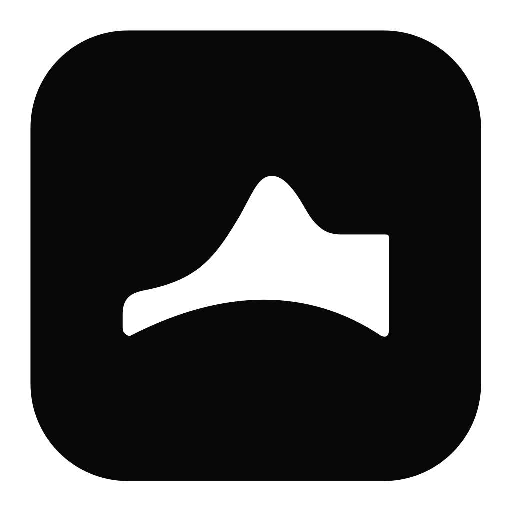
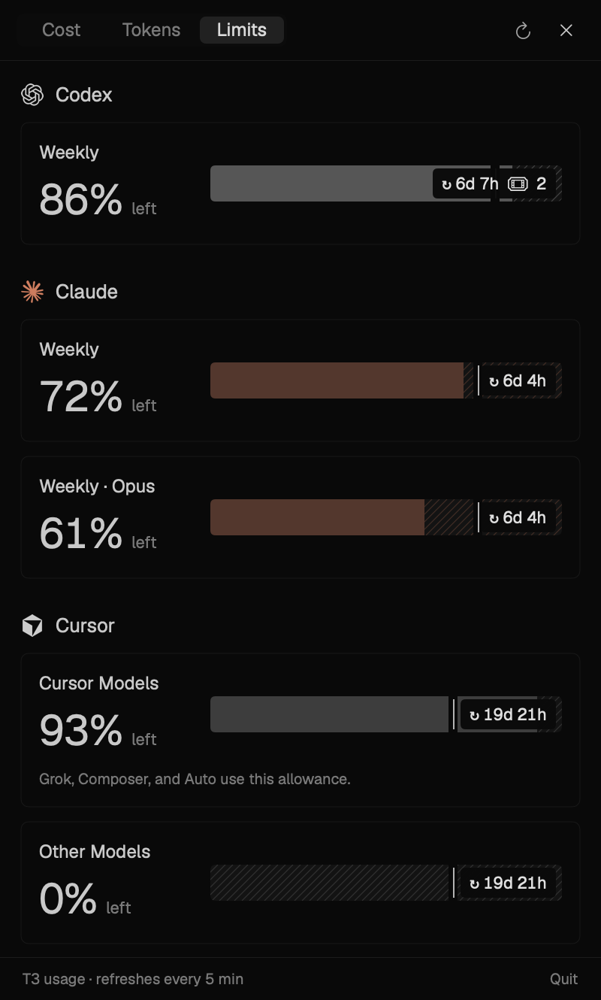
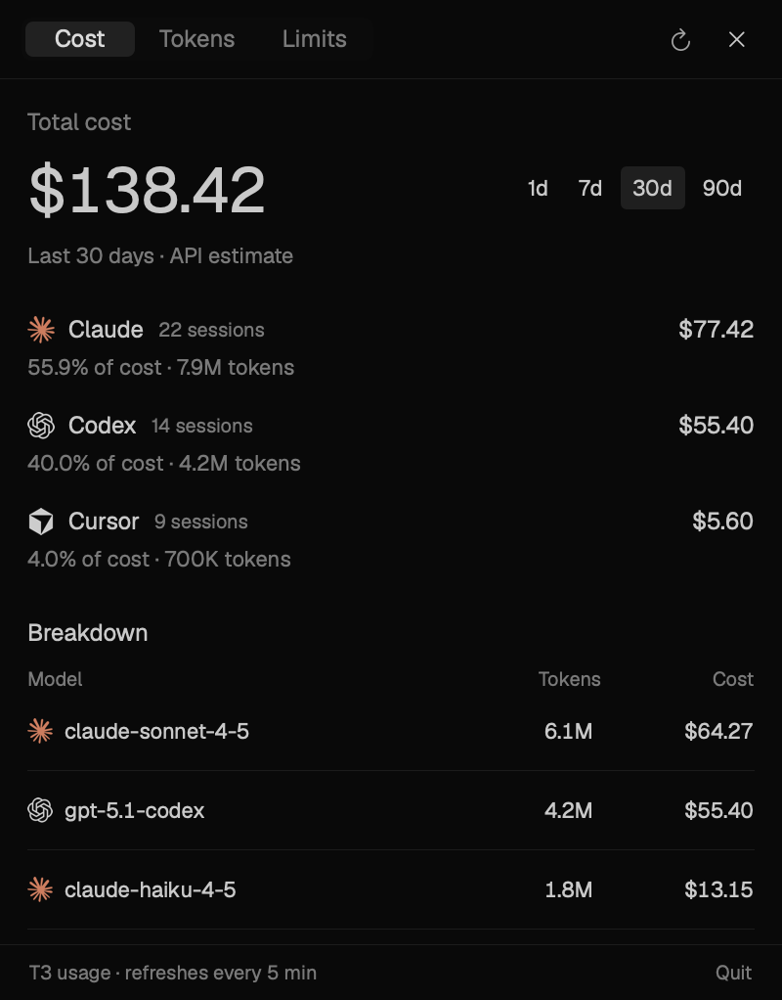
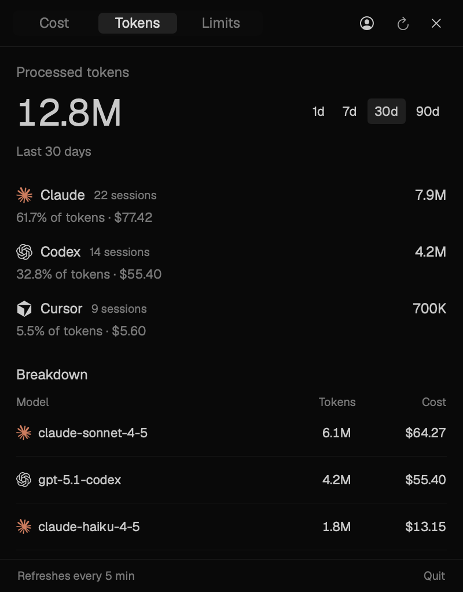

<div align="center">



# Allot

**Know what’s left.**

AI usage, one click from your Mac’s menu bar.

[macOS 14+](#get-allot) · [MIT](LICENSE) · [Details](docs/DETAILS.md)



</div>

### Your AI tools. One quiet panel.

- **Limits** — what’s left and when it resets.
- **Cost** — API-equivalent estimates, down to each model.
- **Tokens** — usage across providers and accounts.

Native, compact and dark. Refreshes automatically. Uses your existing Codex, Claude Code and T3 sign-ins for Cursor.

<table>
<tr>
<td></td>
<td></td>
</tr>
</table>

*Screenshots use sample data. The app reads real usage.*

### Get Allot

macOS 14+, Swift 6 and Xcode command-line tools.

```sh
git clone https://github.com/GithubAnant/Allot.git
cd Allot
./scripts/build-app.sh
open dist/Allot.app
```

Move the app to `~/Applications` to keep it installed.

Cost is an estimate, not your subscription bill. Cursor cost/token history follows T3’s last sync. Builds are ad-hoc signed, not notarized. [Coverage and limitations →](docs/DETAILS.md)

---

Built on [T3 Code](https://github.com/pingdotgg/t3code)’s usage logic. No telemetry.

[Contributing](CONTRIBUTING.md) · [Security](SECURITY.md) · [Credits](THIRD_PARTY_NOTICES.md)
